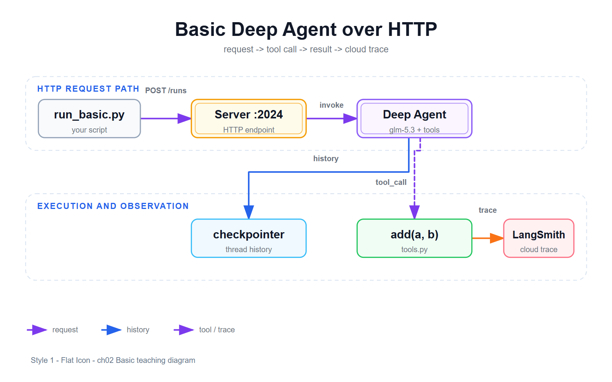

# 02 · Basic 级：走 HTTP 的常驻 Deep Agent

> 代码：本仓库 `code/run_basic.py`（HTTP 客户端）+ `code/start_dev.sh`（服务自救）
> 实际运行位置：WSL Ubuntu `/root/ch02_lite/`；服务端 = 主项目 `/root/research_deepagent`

---

## 一、Lite 和 Basic 差在哪？（本质一句话）

- **Lite**：agent 活在你的**脚本进程里**——脚本一跑完就没了。像"一次性厨师"：每顿饭请一次，请完走人。
- **Basic**：agent 活在一个**常驻服务进程**里（`agentseek dev`，监听 2024 端口）。你的脚本通过 **HTTP 请求**远程使唤它。像"开了家餐厅"：谁都能来点菜，随时来随时点——**这就是所有 AI 产品真实的架构形态**。

## 二、架构全景（先看图再看字）



> 图源：`assets/basic_agent_arch.svg`（SVG 矢量版 + `basic_agent_arch.json` 可编辑源）
> 读图：左上容器 = 一次 HTTP 请求的路径；下容器 = 服务端真正干活的地方。`POST /runs` 是你发的，`tool_call` 是大模型点的，`trace` 是 LangSmith 自动收的。

```
你的脚本 run_basic.py            agentseek dev 服务进程（WSL :2024）
───────────────────              ───────────────────────────────
① POST /threads            →     建一张"餐桌"（thread）
② POST /runs               →     langgraph.json 查表：
   assistant_id="research"         "research" → agent.py 的 graph
   input="用add算..."             ↓
                                  agent.py:166  tools=[tavily_search, think_tool, add]
（脚本只是等 HTTP 响应）      ←    大模型点菜 → 服务进程本地执行 tools.py 的 add()
③ GET /threads/{id}/history ←    拿回全部 4 条消息
```

## 三、add 工具藏在哪？（客户端零感知）

`run_basic.py` 里**没有一行工具代码**。add 的本体在服务端，三处接点（实据行号）：

| 接点 | 位置 | 干什么 |
|---|---|---|
| ① 本体 | `tools.py:126` `def add(a: float, b: float) -> float:` | 真正干活的函数 |
| ② 进口 | `agent.py:28` `from ...tools import add, ...` | 把函数搬进 agent 模块 |
| ③ 注册 | `agent.py:166` `tools=[tavily_search, think_tool, add]` | 挂到 agent 腰带 |

**面试级结论**：客户端只报"agent 的名字"（assistant_id），工具清单是**服务进程启动时**从 agent.py 加载的。以后加新工具 = 只改服务端 + 重启，所有客户端（手机 App 也行）立刻能用——"客户端瘦、服务端重"。

## 四、动手：两条命令

```bash
# 1) 确认服务活着（没活就拉起）
curl -s localhost:2024/ok || (bash /root/ch02_lite/start_dev.sh &)

# 2) 跑（1-2 分钟）
cd /root/ch02_lite && python run_basic.py && cat basic_trace.json
```

预期输出 4 条消息（和 Lite 一模一样的剧本）：

```
- human   content='Please use ONLY the add tool...'
- ai      tool_calls=[('add', {'a': 12345.678, 'b': 8765.432})]
- tool    name=add    content='21111.11'
- ai      content='...21,111.11...'
[SAVED] /root/ch02_lite/basic_trace.json
```

## 五、thread：HTTP 世界里的"餐桌号"

HTTP 是无状态的——服务端天生不认识你。**thread 就是餐桌号**：每次请求带着它，服务端就把这桌的历史对话端上来给大模型看。这就是"多轮对话"在工程上的真相：不是模型记得你，是**服务端替你存着账单**（checkpointer）。

## 六、踩过的坑合集（都替你踩过了）

| 坑 | 现象 | 真相与解法 |
|---|---|---|
| **graph 名不是项目名** | 404 not found | assistant_id 要填 `langgraph.json` 里 `"graphs"` 的键名，本项目是 **`research`**。查配置文件，别猜 |
| **WSL 网络隔离** | Windows 浏览器/curl 连 `localhost:2024` 不通 | WSL2 是 NAT 虚拟机，服务只监听 WSL 内的 127.0.0.1。**在 WSL 终端里访问**就没问题 |
| **服务会消失** | 隔天 `Connection refused` | WSL 空闲自动关机把服务带走了。`bash start_dev.sh &` 一键救活 |
| **systemd-run 传参炸** | 服务秒退 status=2 | 外层 $PATH 展开后带空格路径，参数分词炸裂。**用 .sh 脚本文件启动**，别拼长命令 |
| **改 .env 不生效** | 加了 key 没 trace | 环境变量是启动瞬间的快照，**改配置必须重启服务** |

## 七、自测 2 题

1. `run_basic.py` 想让服务端换一个新工具（比如 `multiply`），客户端代码要改几行？
2. 为什么同一个 thread 连续 POST 两次，大模型能"记得"上一轮说了什么？

<details>
<summary>参考答案</summary>

1. **0 行**。客户端只报 assistant_id；工具在服务端 tools.py 定义 + agent.py 注册 + 重启服务即生效。
2. 不是模型记得——是服务端 checkpointer 按 thread_id 存了历史消息，每次请求时把历史端给模型看。
</details>

---

## 下一关预告

餐厅开起来了，但后厨是黑盒：大模型每步在想什么、工具何时被调、耗时多少 token 花在哪——**03 · LangSmith**：零代码给后厨装监控。
