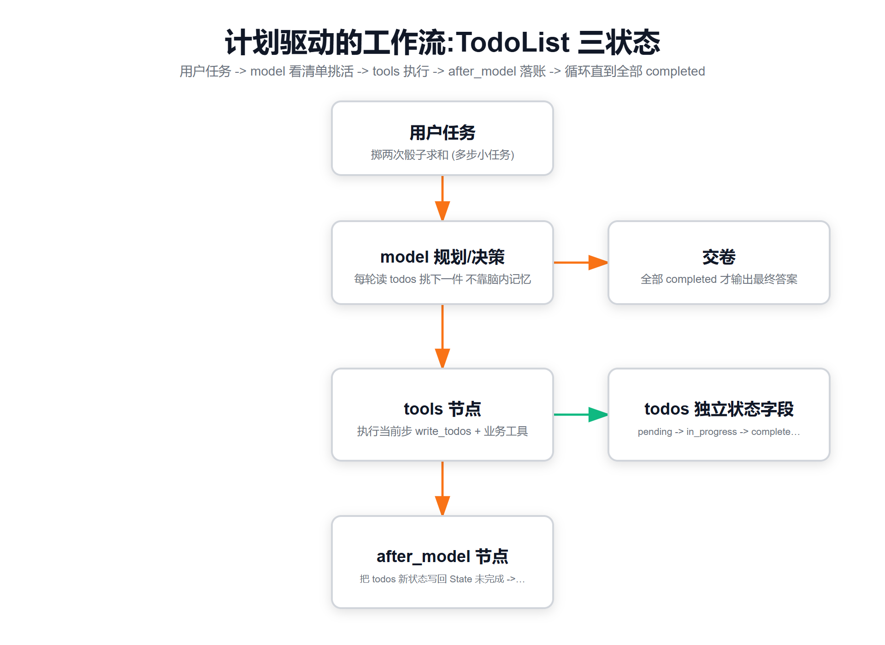
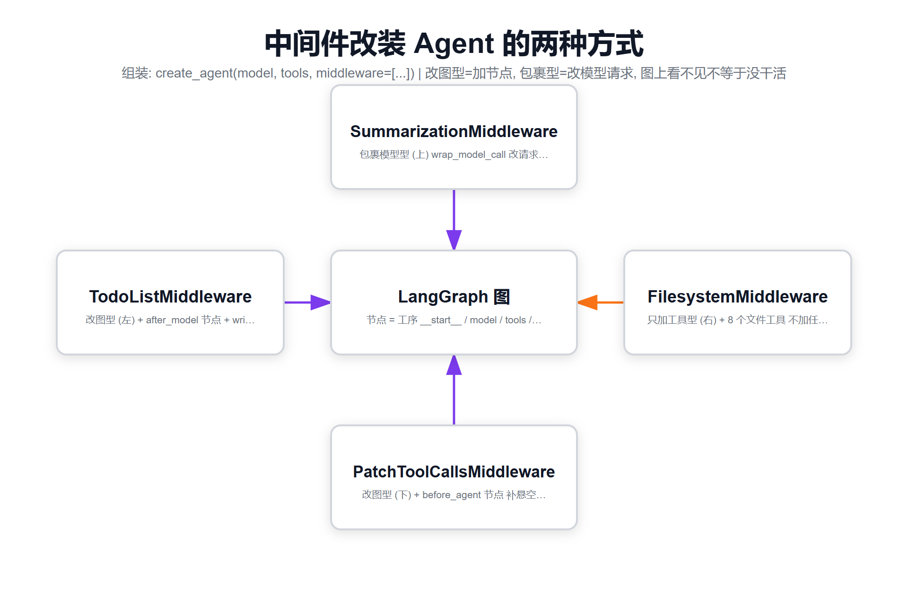

# 02 · Lab1：中间件到底给 Agent 图动了什么手术？



*图1 · 计划驱动工作流：write_todos 落账 → tools 干活 → after_model 对账的循环*



*图2 · 中间件改装 Agent 的两种方式：改图型(加节点) vs 包裹型(改请求，图上看不见)*

> 对应代码 `../code/lab1_todo_lifecycle.py`，证据 `../evidence/lab1_out.txt`

## 一、实验设计（大白话）

问模型同一个任务："掷两次骰子，求和"。跑两遍：

- **B1 对照组**：裸 `create_agent(model, tools=[roll_dice])`——不加任何中间件
- **B2 实验组**：加一个 `TodoListMiddleware()`——就这一行区别

然后拿"显微镜"（`agent.get_graph().nodes`）看两张图的节点差在哪，再数模型调了哪些工具。

## 二、结果一：图结构变化（离线可复现）

```
裸 create_agent          : ['__start__', 'model', '__end__']
+ TodoListMiddleware     : ['__start__', 'model', 'tools', 'TodoListMiddleware.after_model', '__end__']
```

三条大白话解读：

1. **裸 agent 连 tools 节点都没有**——注意 B1 是传了 roll_dice 工具的，但 Lab 里裸对照组是不带工具的版本，图里就真的只有 model。LangGraph 的图是"按需生成"：没有工具，就不给你画工具节点。
2. 加了 TodoList 后冒出 **tools 节点**——因为中间件"外挂"了一个 `write_todos` 工具进来，有工具就得有地方执行。
3. 冒出 **`TodoListMiddleware.after_model`** 节点——模型每说完一轮话（吐出 tool_call），这个节点就把 todos 的最新状态（in_progress/completed）**写回 Agent State**。没有它，模型就算调了 write_todos，状态也存不进图里。

### 一图流（对应 assets/d1）

```
用户消息 → [model] → 有tool_call? ─是→ [tools 执行] → [after_model 同步todos] → 回到 model
                │
                否（纯文本）→ __end__ 输出答案
```

## 三、结果二：模型行为对比（真跑 LLM）

| 指标 | B1 无 TodoList | B2 有 TodoList |
|---|---|---|
| 工具调用序列 | `roll_dice, roll_dice` | `write_todos → roll_dice → roll_dice → write_todos → write_todos` |
| write_todos 次数 | 0 | **3** |
| `result['todos']` | None（字段都没有） | 3 条，全部 completed |

B2 里模型干了三件事，完全像个真人项目经理：

1. **开工前**：先调 `write_todos` 把"掷第一次/掷第二次/求和"三条写进清单
2. **干活中**：干完一步就把对应条目标 completed（再调一次 write_todos）
3. **收尾**：最后一次全量确认清单

### todos 长什么样？（真实证据）

```json
[
  {"content": "掷第一次6面骰子", "status": "completed"},
  {"content": "掷第二次6面骰子", "status": "completed"},
  {"content": "汇总两次点数之和", "status": "completed"}
]
```

## 四、三状态生命周期：pending → in_progress → completed

这是规划中间件的灵魂，也是 **Claude Code / Deep Agents 官方提示词**同款设计：

| 状态 | 含义 | 大白话 |
|---|---|---|
| `pending` | 还没开始 | "排着队呢" |
| `in_progress` | 正在做 | "手上这单"（**同时只该有一个**） |
| `completed` | 做完了 | "已画勾" |

关键规则（写给模型的说明书，写进了 write_todos 的工具描述）：
- 一次只把**一个**任务标 in_progress（强迫专注，防"假装并行全都做一半"）
- 做完立刻标 completed 再开下一件（强迫及时交割）
- 学到新信息导致计划变化 → 直接改写整个清单（计划是活的）

**谁维护状态？** 模型自己。中间件只提供"账本"（state 字段）和"笔"（write_todos 工具），不监督。所以 lab1 的教学提醒写的是：**清单画勾 ≠ 真做完**，生产上要拿产物（文件、返回值）交叉验证，防"账面完工"。

## 五、你可能会问

**Q：B1 没中间件也把任务做对了，那 TodoList 有啥用？**
两步小任务当然不需要。但第 5 章会看到 20+ 步的深任务：没有外置清单，模型全靠"脑内记忆"，走到第 10 步就开始丢步骤、重复劳动。todos 是把"工作记忆"外化成"看得见的账本"。

**Q：todos 存在哪？是消息吗？**
不是消息，是 Agent State 的**独立字段**（和 `messages` 平级）。这就是 lab2 的伏笔：它能不能活过一次 invoke，取决于 Checkpointer。

**Q：write_todos 是哪来的？**
`TodoListMiddleware` 注入的。v0.7.8 里它**不是** create_agent 自带，必须显式挂中间件（`create_deep_agent()` 预设除外，那里全家桶默认装好）。
