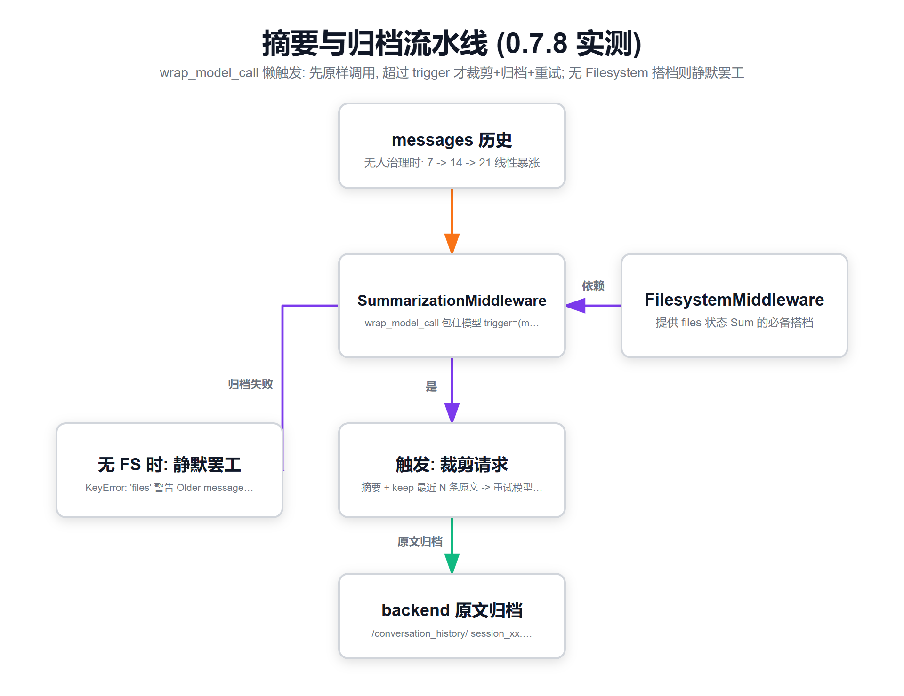

# 04 · Lab3 + probe12：摘要中间件的"锚定"机制（含 0.7.8 版本大坑）



*图3 · 摘要三参数与归档管线：消息爆表 → 归档到文件 → 裁剪后请求 → 正常调模型*

> 对应 `../code/lab3_summarization_anchor.py` 与 `../evidence/probe12_out.txt`

## 一、为什么需要摘要？

长任务聊到几百条消息，两个麻烦：

1. **贵**：每轮都把全部历史塞给模型，token 账单爆炸
2. **糊**：上下文太长模型注意力稀释，早期关键约定被"淹没"

对照组实测（无摘要）：三轮任务消息数 `7 → 14 → 21`，线性增长，没人管。

## 二、装上 SummarizationMiddleware 就完事了吗？——三个参数决定一切

```python
SummarizationMiddleware(
    model,                     # 用哪个模型来写摘要（干活的笔）
    backend=backend,           # 摘要前的原文归档到哪（必须有！）
    trigger=("messages", 10),  # 什么时候触发：消息数>10
    keep=("messages", 2),      # 保底保留最近2条原文
)
```

**v0.7.8 实测签名**（probe11 离线验证）：
- `trigger` 默认 `None` —— **装了但永远不触发**，等于白装！必须手动设
- `keep` 默认 `("messages", 20)`
- `trim_tokens_to_summarize` 默认 4000 —— 拿去写摘要的原文最多 4000 token

## 三、lab3 实测：归档真的发生了，但别只盯着消息计数

实验组配置三件套（StateBackend + Filesystem + Summarization, trigger=10 轮五轮）：

| 观察 | 结果 |
|---|---|
| 消息数轨迹 | 8 → 14 → 20 → 24 → 28（**没降**） |
| Backend 文件 | `conversation_history/session_da83….md` **已生成**，头部带 "Summarized at" |
| todos | 压缩归档后**完好无损**（它不在 messages 里，摘要动不了它） |

第一眼"消息数没降"像是没生效？错——**看文件别只看计数**。0.7.8 的机制变了（见下节），归档发生在 backend，messages 的删减由另一套 overflow/eviction 逻辑管（token 级）。判据是归档文件 + 后续轮次行为，不是 `len(messages)`。

## 四、probe12：重大版本坑——没有 FilesystemMiddleware，摘要"静默罢工"

probe12 只挂 StateBackend + Summarization（**故意不挂 Filesystem**），三轮跑完：

```
Exception offloading conversation history to .../session_3a2a….md (5 messages): KeyError: 'files'
Offloading conversation history to backend failed during summarization.
Older messages will not be recoverable.      ← UserWarning，不抛异常
--- 第2轮后: 16 条 ---（原文一条没少，摘要一条没插）
--- 第3轮后: 22 条 ---
```

**发生了什么**：中间件想把被摘要替换掉的老消息**卸载到 backend 文件**里（`/conversation_history/session_xxx.md`），但 State 里根本没有 `files` 字段（那是 FilesystemMiddleware 负责的）→ KeyError → 捕获 → 只发一条 UserWarning → **整个摘要动作静默放弃**，历史原样膨胀（8→16→22）。

大白话：**摘要中间件和文件系统中间件是一对搭档**。0.7.8 里 Summarization 的"归档"环节依赖 FS 的 files 状态。只装 Summarization 不装 Filesystem = 装了台碎纸机但没配档案柜——它不敢碎（碎了就找不回来），干脆不碎。

**排障口诀**：日志里搜 `Older messages will not be recoverable` / `KeyError: 'files'` = 你的摘要中间件在空转。修法：把 FilesystemMiddleware 一起挂上（`create_deep_agent()` 全家桶默认就带，所以官方示例从来不踩这个坑）。

## 五、源码考古：0.7.8 的摘要其实"不改图、不改状态"

读 `_DeepAgentsSummarizationMiddleware` 源码（48673 字符），关键设计：

1. **wrap_model_call 模式**：它不注册任何图节点、不动 LangGraph state，而是**包裹模型调用本身**，直接改"发给模型的请求"
2. **懒触发**：先按原样调模型；只有触发条件满足或爆 `ContextOverflowError` 时，才走摘要路径并**重试**
3. 溢出时把"保留区"的老消息**分批卸载**成 backend 里的 per-TM 文件（就是那个 KeyError 的现场）
4. 摘要事件记在中间件私有状态 `_summarization_event`，不污染你的业务状态

这和书里讲的"经典版"（langchain 自带 SummarizationMiddleware 在 before_model 里把 state.messages 换成摘要消息）**机制不同但目标一致**。读书时若看到"messages 里会出现一条 summary 消息"而实测看不到，不是你错了，是版本演进了：**0.7.8 = 归档到文件 + 请求级裁剪；经典版 = 状态级替换**。

## 六、todos 为什么是"定海神针"

摘要把聊天记录压缩、归档，但 `todos` 是 State 的**独立字段**，不参与摘要。所以哪怕几百轮之后老消息全进了档案柜，**计划清单永远一条不少地摆在最显眼处**——这就是第 4 章"规划与上下文工程"成对出现的原因：**计划外置（TodoList）+ 历史压缩（Summarization）**，一个保方向，一个保内存。
