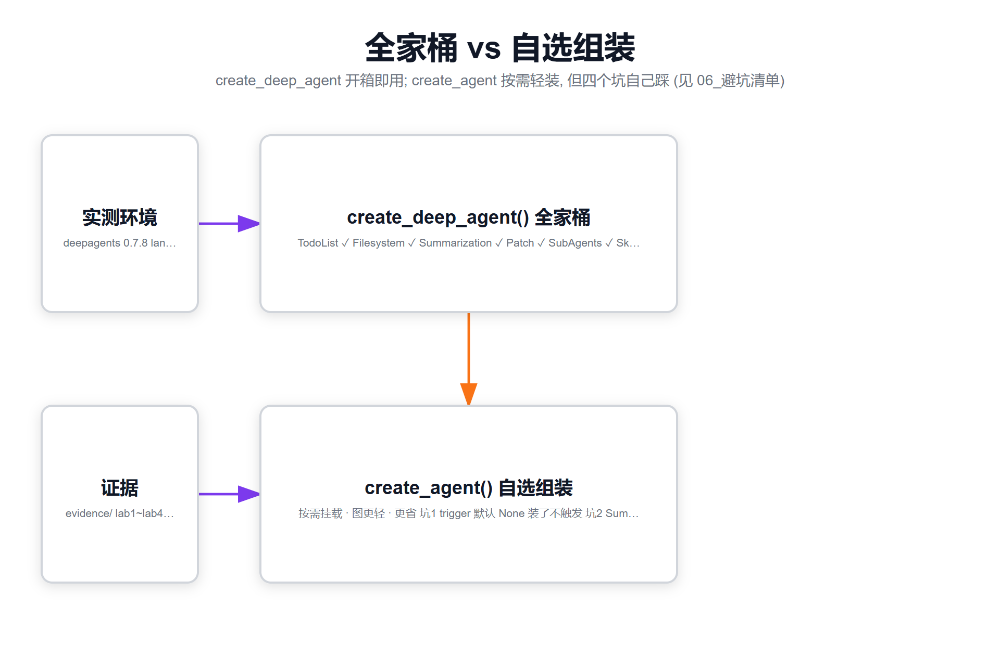

# 05 · Lab4：悬空 tool_call 的"保险丝"与中间件全景表



*图4 · 全家桶 vs 自选组装：同能力两种拿法，坑1~4 的来源*

> 对应 `../code/lab4_patch_and_panorama.py`，证据 `../evidence/lab4_out.txt`、`lab4_evidence.json`

## 一、什么叫"悬空 tool_call"？

消息历史本质是一问一答的**配对结构**：AI 说"我要调工具 shout"（tool_call），后面必须紧跟一条工具结果（ToolMessage）。像一栋楼，tool_call 是钢筋，ToolMessage 是浇的混凝土，**一根钢筋一条混凝土，必须成对**。

但现实会出岔子：
- Agent 干到一半**进程崩了**：tool_call 发出去了，结果没写回来
- 人为拼接历史（回放、注入、测试）：漏了配对

这时消息历史变成"半拉子工程"——**钢筋裸露**。下次带着这份历史去请求模型，API 直接拒收：

```
OpenAIInvalidRequestError: Error code: 400
'An assistant message with tool_calls must be followed by tool messages
 responding to each tool_call_id. (insufficient tool messages following
 tool_calls message)'
```

## 二、实验：裸奔 vs 带保险丝

构造同样一条"楼没封顶"的历史（AI 发了 tool_call，人为不给结果），分别喂给两个 agent：

| Agent | 结局 |
|---|---|
| 裸 `create_agent` | **400 报错**（上面的原文） |
| + `PatchToolCallsMiddleware` | **正常返回** ✓，共 5 条消息，悬空位置被补上一条 ToolMessage |

补丁长这样（真实证据）：

```
ToolMessage: "Tool call shout with id call_dangling_1 was cancelled - …"
```

大白话：保险丝在 agent 开跑前（before_agent 节点）**巡楼检查**，发现裸露的钢筋就补一块"此路停工"的告示牌。模型看到的是合法的完整结构，于是正常继续对话。

## 三、全景表：五个配置的图结构对比（离线可复现）

| 配置 | 图节点 | 外挂工具 |
|---|---|---|
| 裸 create_agent | `__start__, model, __end__` | — |
| + TodoList | `+ tools, TodoListMiddleware.after_model` | `write_todos` |
| + Filesystem | `__start__, model, tools, __end__`（无新节点） | ls/cat/write/edit/glob/grep/read_file/multi_edit 等 **8 个** |
| + Summarization | 无新节点 | 无 |
| + PatchToolCalls | `+ PatchToolCallsMiddleware.before_agent` | 无 |

三句大白话总结：

1. **有的中间件改图**（TodoList 加节点、Patch 加节点），**有的不改图只改行为**——Filesystem 只是"塞工具"，Summarization 干脆**藏在模型调用的包裹层里**（wrap_model_call），图上根本看不见
2. 想知道自己的 agent 被改装成什么样，一行 `agent.get_graph().nodes` 就能看（别猜，打印）
3. `create_deep_agent()` 全家桶 = 上面所有装备一次配齐（还带 SubAgent、Skills 等）；自己 `create_agent` 组装时，**Patch 这根保险丝很容易忘**——忘了也能跑，直到某天进程崩过一次后永远起不来，报的还是那个 400

## 四、为什么 deepagents 默认全家桶要带它？

崩溃不可怕，可怕的是**崩完之后连重启都起不来**（历史里有悬空钢筋，每次请求都 400）。PatchToolCallsMiddleware 就是"断电重启自愈"能力的一部分：崩溃留下的烂摊子，下次启动自动收拾干净。生产环境必装。
